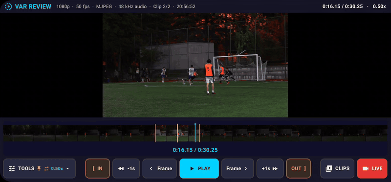
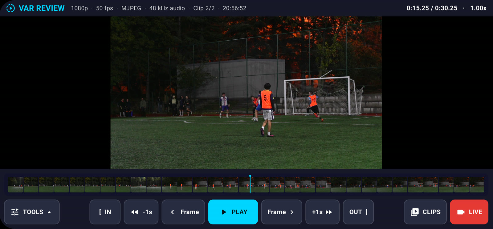
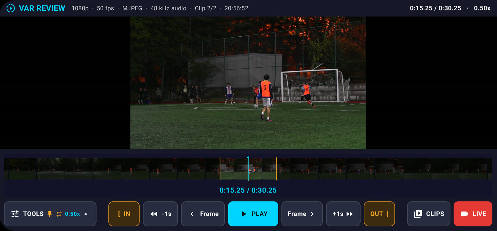
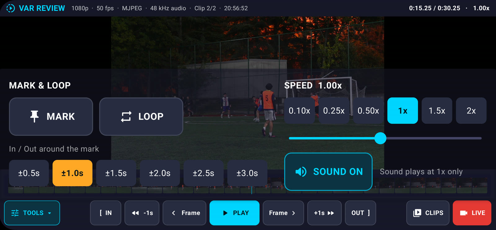
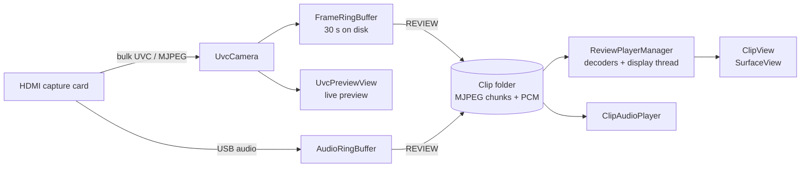

# VAR Camera

**A video assistant referee (VAR) system for amateur football.**

<p align="center">
  
</p>

A camera films the match. A cheap HDMI capture card feeds the picture into an Android
tablet or phone, and the app always keeps the last 30 seconds of play. When a moment is
disputed, one tap opens those seconds in a review player built for refereeing decisions:
frame by frame, in slow motion, looped around the moment of contact, zoomed in.

It is used at real five-a-side tournament matches, where the referee walks to the
touchline and checks the replay on the tablet.

## The story

**It started with a sentence I kept hearing.** We play football regularly on the
Hacettepe University campus, and after almost every match someone would say *"if only
someone had recorded our match"*. I took that as demand. I set up my camera and tripod
and started filming matches.

**Then I made it reachable.** To get to more of the people who play, and who wanted
their games filmed, I opened an Instagram page and started posting match clips. The
page built engagement, and the service spread by word of mouth. I have now filmed more
than 100 matches.

**I never treated it as "set up the camera, film the match".** Every match was a
chance to make the service better, and the biggest step was bringing VAR, the video
review system used in professional football, to amateur matches. For serious matches
such as tournaments, the referee can now check a disputed decision on video before
making the call.

**There was no app for it, so I built one.** I could not find an existing app that
did what pitch-side review needs, so I developed this one from scratch, working with an
AI coding assistant throughout. That meant writing a USB video driver, a recording
buffer and a frame-accurate replay player, and testing it at real matches until it held
up.

For me, this project is what entrepreneurship looks like in practice: I noticed a demand
nobody was serving, built the supply for it, and kept turning a simple service into a
better product.

## Screenshots

| Review screen | Marked moment with a loop range at 0.5× |
|---|---|
|  |  |

| TOOLS menu: mark, loop range, speed and sound |
|---|
|  |

## What it does

**Live**
- 1080p live picture at 50 fps from the capture card.
- A rolling 30-second buffer: press **REC** once and the last 30 seconds are always kept.
- A clear *No Signal* screen when the camera is off or unplugged, instead of a frozen picture.
- Warns when the picture is live but not being recorded; a red frame shows while recording.
- HDMI audio level meter, automatic reconnection and an on-device diagnostic log.

**Review**
- **REVIEW** turns the last 30 seconds into a clip in about a second, at full original
  quality, while recording carries on underneath.
- Exact frame stepping, ±1 s jumps, and speeds from 0.10× to 2×.
- **MARK** the moment of contact, set **IN** / **OUT** points and **LOOP** the range.
- Pinch to zoom into the full-resolution frame.
- A timeline that opens from a whole-clip overview into a per-second filmstrip.
- Frame-accurate timecode (`0:14.49` = second 14, frame 49) and sound in sync at 1×.
- A single row of controls, so the picture stays visible while scrubbing.

## Hardware

```
Camera ──HDMI──▶ USB HDMI capture card ──USB OTG──▶ Android tablet or phone
```

| | |
|---|---|
| **Camera** | Anything with a clean HDMI output, 1080p at 50 or 60 fps |
| **Capture card** | A USB card that streams MJPEG over **UVC bulk transfer** (inexpensive MS2109 / MS2130-class cards) |
| **Device** | Android 7.0+ with USB host (OTG) support |

## Engineering highlights

**A USB video driver written from scratch.** Off-the-shelf Android UVC libraries showed
a black screen with this class of capture card, because the card streams over bulk
transfers rather than isochronous ones. The app talks to the card directly through the
Android USB Host API instead. It parses the USB descriptors, negotiates MJPEG 1080p50
with UVC probe/commit requests, reads the bulk endpoint and reassembles frames from the
UVC payload headers.

**Never re-encoding the video.** The test tablet's H.264 encoder topped out at about
43 fps, which drops frames a referee might need. So the app stores the JPEG frames
exactly as the card sends them, in one-second chunk files forming a 30-second ring
buffer on disk. Saving a clip becomes a file copy: no quality loss, no CPU cost, about a
second.

**Frame-exact playback on a budget tablet.** Every frame is an independent JPEG, so any
frame can be shown instantly. A 1080p JPEG takes about 20 ms to decode on the test
tablet, which is the whole frame budget at 50 fps. Two decoder threads therefore work
ahead of the playhead while a display thread draws to a `SurfaceView`. Zoom crops the
full-resolution frame instead of scaling the view.

**Telling "camera off" from "nothing moving".** A powered-off camera can leave the card
sending a frozen or blank picture. Pixel-level freeze detection misfired on a static
scene, so the driver fingerprints the compressed JPEG bytes instead. A live camera's
encoder never produces two byte-identical frames, even when nothing in front of it moves.

**Audio in sync.** The card delivers the camera's sound on a separate USB audio
interface. The app records it with timestamps on the same clock as the video frames,
and plays it back following the picture's clock with drift correction. Building this
exposed a timing bug: rounding every frame gap to whole milliseconds had been running
"1×" playback 2.5% fast.

**Built for the pitch.** After unexplained failures at matches, I added an on-device log
of USB, signal, battery and temperature events, shareable from the app, so a failure
at the pitch can be diagnosed from evidence afterwards instead of guesswork.

## Architecture



| Package | Contents |
|---|---|
| `uvc/` | USB video driver and live preview |
| `recording/` | Video and audio ring buffers, clip storage |
| `review/` | Clip readers, frame-accurate player, audio playback, render surface |
| `diag/` | Diagnostic log |
| `MainActivity.kt`, `UVCCameraFragment.kt` | Jetpack Compose UI for the review and live screens |

A 30-second 1080p50 clip takes about 400 MB of match footage. Up to 20 clips are kept,
and 1 GB of storage is always left free.

**Tech:** Kotlin · Jetpack Compose · Android USB Host API (UVC) · AudioRecord / AudioTrack · SurfaceView rendering · multithreaded JPEG decoding

## Building

Requires JDK 17 and the Android SDK (API 34).

```bash
./gradlew assembleRelease
```

The APK is written to `app/build/outputs/apk/release/`.

## License

All rights reserved. The code is published for viewing. Please ask before reusing it.
